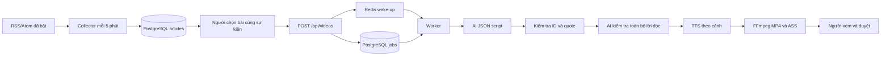

# Thiết kế MVP

## Luồng hiện tại

## Quyết định

- Một Go binary với các chế độ riêng, tránh chia nhiều microservice ngay ở Phase 1. Collector, API và worker vẫn chạy ở process/container độc lập.
- PostgreSQL giữ jobs bền vững. Tạo video, liên kết bài và tạo job trong một transaction. Redis chỉ báo đánh thức worker, nên mất Redis không làm mất job; worker poll lại sau khoảng 5 giây.
- Claim bằng `FOR UPDATE SKIP LOCKED`; lease 2 phút, heartbeat mỗi 30 giây, token riêng cho mỗi lần claim. Worker quá hạn không được ghi kết quả của lần claim mới. Render vào thư mục riêng từng attempt để không ghi đè MP4 của worker thắng lease.
- Lỗi HTTP 4xx từ AI (trừ 408/429) kết thúc ngay với failed; AI trả claims/scenes rỗng vì thiếu dữ kiện cũng kết thúc ngay; các lỗi còn lại thử tối đa 3 lần, chờ 2/4 phút với HTTP 429/5xx, 30 giây với lỗi tạm thời khác; timeout một attempt 20 phút. Nếu worker chết ở lần cuối, reaper đánh dấu failed sau khi lease hết hạn. Đây là xử lý at-least-once, không phải exactly-once: API AI/TTS có thể bị gọi lại và tính phí khi retry.
- Nguồn và bài được lưu trước production; không tự lên lịch sản xuất video hàng loạt. Người chọn bài cùng sự kiện để chưa cần semantic clustering. URL chỉ loại bỏ tracking parameters; query có nghĩa vẫn giữ.
- Dedup URL toàn cục, hash theo từng nguồn. Hash không loại các bản tin khác nguồn giống nhau để còn lưu provenance; chưa phát hiện cùng sự kiện ở mức ngữ nghĩa.
- Collector đọc title và ưu tiên content:encoded của RSS hoặc content của Atom, rồi mới dùng description/summary. Worker chỉ tải trang VnExpress được chọn nếu nội dung đang lưu dưới 70 từ; không sử dụng ảnh đính kèm. Fetch giới hạn 4 MiB, timeout, số redirect và chặn IP nội bộ tại lúc dial để giảm SSRF/DNS rebinding.
- Prompt coi nội dung RSS là dữ liệu, kiểm tra strict JSON schema, từ chối AI refusal/truncated output. Lưu draft không đạt kiểm tra để chẩn đoán; không render draft này. Validate ID bài, quote có thật và claim reference; checker thứ hai phải trả đúng một verdict cho mỗi cảnh, mọi cảnh phải supported trước TTS/render.
- `AI_PROVIDER` chọn OpenAI hoặc Google Gemini cho Generate/Check; `TTS_PROVIDER` chọn độc lập hoặc mặc định theo AI_PROVIDER. Giữ key, base URL, text model, TTS model và voice riêng cho từng nhà cung cấp. Worker/API kiểm tra đủ key của cả hai bước trước khi nhận video. Không có fallback sang provider khác khi lỗi. Thay provider cần tạo lại container; job đang queued sẽ dùng cấu hình worker ở lúc nhận job.
- OpenAI gọi Chat Completions + speech, Google gọi native generateContent với system instruction và JSON schema. Google bỏ thought parts, chặn candidate không STOP/prompt bị block, giải mã inlineData audio. WAV giữ nguyên, PCM signed 16-bit little-endian mono được đóng gói WAV để ffprobe xác định thời lượng. Google tích hợp Gemini Developer API, chưa có Vertex AI/Google Cloud TTS.
- AI checker chỉ kiểm tra tính hỗ trợ bởi nguồn đầu vào. Chưa xác nhận độ độc lập của nguồn, chưa tìm thêm nguồn hoặc đánh giá chất lượng nguồn tự động. `pending_review` là trạng thái cần kiểm duyệt biên tập.
- Lời đọc TTS từng cảnh, lấy thời lượng bằng ffprobe để phụ đề không lệch qua cảnh khác. Thời gian cụm từ trong cảnh là ước lượng. H.264/AAC, 1080×1920, 30fps, yuv420p, faststart; mẫu chữ dùng font Noto Sans.
- Bearer admin token bắt buộc cho `/api/*`, không có tài khoản nhiều người hay phân quyền. Host mặc định bind loopback. Khi mở cho đội dùng, cần reverse proxy HTTPS và xác thực người dùng.

## Dữ liệu lưu

`news_sources`: nguồn, URL feed, language/category, quyền dùng ảnh/video (mặc định false), ghi chú quyền dùng và lỗi fetch. `news_articles`: URL chuẩn hóa, title, mô tả, hash, thời gian. `videos`: trạng thái, script JSON, verdict JSON, file, thời lượng, lỗi và thời điểm duyệt. `video_sources`: article IDs gốc để đối chiếu; category nguồn chưa tự phân loại tin. `jobs`: attempts, thời điểm thử lại, lease, token và lỗi.

Migration runner đọc các file SQL theo tên, dùng transaction và advisory lock. `schema_migrations` lưu checksum từng file để chặn sửa migration đã chạy. Database Phase 1 chưa có sổ migration được bootstrap lại bằng 001 idempotent, sau đó áp dụng 002 để thêm `videos.parent_id` và `draft_script`. Nâng cấp không xóa dữ liệu.

## Dashboard và sửa kịch bản

Next.js server chạy riêng ở cổng 3000. Go API vẫn ở cổng 8080. Dashboard đăng nhập bằng ADMIN_TOKEN, cấp cookie HttpOnly SameSite Strict có chữ ký HMAC, hiệu lực 12 giờ. Server Next.js giữ admin token và gửi Bearer đến Go; browser chỉ có session cookie. Các thao tác ghi kiểm tra Origin khớp WEB_ORIGIN, proxy chỉ cho phép đường dẫn/method xác định sẵn. Stream MP4 chuyển tiếp Range/Content-Range để tua video mà không tải toàn bộ vào bộ nhớ.

Tổng quan và danh sách poll mỗi 10 giây khi tab đang hiển thị. API overview chỉ đưa số lượng và tên provider/model/voice ra giao diện, không đưa API key. Quản lý nguồn dùng API cũ; nút thu thập gọi endpoint cho một nguồn đang bật, với giới hạn fetch RSS hiện có.

POST `/api/videos/{id}/revisions` nhận script đã sửa, kiểm tra grounding trên các bài của video gốc, tạo video/job mới trong transaction và giữ parent_id. Worker có draft thì bỏ bước Generate nhưng vẫn chạy Validate và AI Check trước TTS/render. Video cũ, quyết định duyệt cũ và provenance giữ nguyên. Sửa lời đọc cập nhật phụ đề, không sửa trực tiếp MP4 đã được duyệt. Các dữ kiện/trích dẫn chỉ xem trên dashboard; API vẫn validate nếu client gửi script khác.

Chưa có event clustering tự động; biên tập viên chọn bài cùng sự kiện. Dashboard và script revisions là bước quản trị của Phase 2, semantic grouping/pgvector là phần tiếp theo.

## Vận hành

Backup PostgreSQL và volume videos. Theo dõi số jobs failed, last_error của nguồn, dung lượng ổ đĩa và mức sử dụng API. Các attempt lỗi có thể để lại audio/phụ đề/thư mục render phục vụ chẩn đoán; chưa có retention/garbage collection. Không tự xóa volume. Đừng tăng nhiều worker trước khi đặt hạn mức API và lịch dọn artifact.

Không có auto-publish trong MVP. Phê duyệt API chỉ ghi quyết định của người dùng, không thực hiện thao tác mạng với TikTok.

## Lộ trình

1. Chạy thử với nguồn được phép, kiểm tra chất lượng giọng Việt, phụ đề và dữ kiện bằng người biên tập.
2. Dashboard và script revisions đã có; tiếp tục event/claims schema, embeddings/pgvector, grouping và tách nguồn độc lập.
3. Media assets có license/provenance, template, alignment, object storage và retention.
4. TikTok OAuth/publishing jobs, lịch đăng và retry riêng, chỉ sau duyệt.
5. Analytics và đo chất lượng hook, retention, mix chủ đề.

Lỗi AI HTTP 429/5xx được chờ 2 phút trước lần 2, 4 phút trước lần 3; các lỗi tạm thời khác chờ 30 giây. Log `video retry scheduled` kèm `retry_after` nghĩa là job còn queued; `video failed` chỉ xuất hiện khi kết thúc. Không tự đổi model/provider. Backoff không đảm bảo model hết quá tải.

Tạo video từ một bài VnExpress: worker bổ sung các đoạn nội dung chính từ trang bài gốc nếu RSS đang lưu dưới 70 từ, giữ lại mô tả ban đầu để không mất bằng chứng. Chỉ tải bài được chọn, HTTPS trên vnexpress.net/www.vnexpress.net, chặn redirect ngoài nguồn và IP nội bộ, giới hạn 4 MiB/30 giây. Nếu tải/trích xuất thất bại, log `load full article` và không gọi AI/TTS. Nguồn khác vẫn dùng nội dung feed. Bài có nội dung đủ dài vẫn phải vượt kiểm tra dữ kiện.
